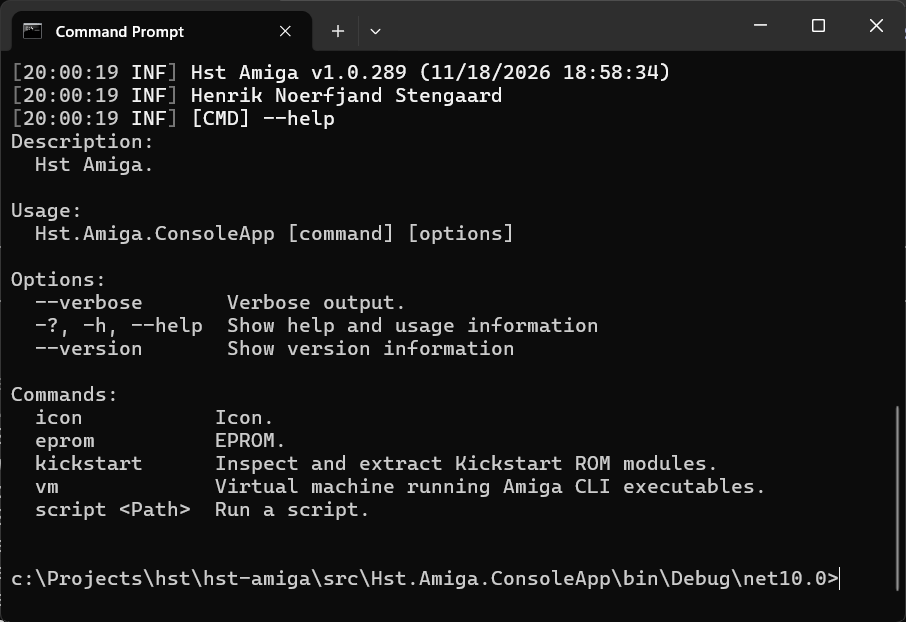

# Hst Amiga

Hst Amiga is a library for reading and writing Amiga partition table, file systems, data types and running Amiga CLI executables in a virtual machine. It's available as Nuget packages for .Net and a console application.

## Features

Hst Amiga Nuget package contains following features:
- Data types:
  - Disk objects: Read and write icons and tool types. Supports planar, new icon and color icon (glow icon) images, and true color icons (PNG icons).
  - UAEFSDBs: Read and write UAEFSDB metadata files created by WinUAE.
  - UAE metafiles: Read and write UAE metafiles created by FS-UAE.
  - Hunk files: Read hunk executables and resident structures (romtags).
  - IFF: Write interleaved bitmap (ILBM) images.
- Rigid Disk Block (RDB), Amiga partition table:
  - Read and write rigid disk block, partitions, file systems and bad blocks.
  - Recover a broken rigid disk block by fixing it or rebuilding it from file systems found on the disk.
- File systems:
  - Read, write and format Fast File System (FFS) partitions and adf images. Supports DOS types DOS0-7.
  - Read, write and format Professional File System 3 (PFS3) partitions. Supports DOS types PFS3, PDS3.
  - Read, write and format Smart File System (SFS) partitions. Supports DOS type SFS\0.
  - Doctors to check and repair FFS, PFS3 and SFS volumes, and salvage files from damaged volumes to a directory or another volume.
- Read version strings from `$VER` or the resident structure id string in Amiga files.
- Build EPROMs from Kickstart ROMs.

Hst Amiga Vm Nuget package contains following features:
- Virtual machine running Amiga CLI executables, similar to vamos from amitools.
- Interpreting 68000 and 68020 cpu with full integer instruction set.
- Emulated exec.library, dos.library, utility.library, version.library and math libraries mapping files, directories and console to host.
- Adf and disk images mounted as volumes using FFS, PFS3 and SFS support of Hst Amiga.
- UAE metadata for Amiga names, protection bits and comments in host directories.
- AmigaDOS shell running scripts with Execute and interactive command lines.

Hst Amiga console version comes with following features:
- Icons
  - Display information about icons.
  - Create, update and fix icons.
  - Import and export icon images, supporting png and bmp image formats.
  - Convert and delete icon images of types planar, new icon and color icon.
  - Import and export tool types.
- EPROMs
  - Build EPROMs from Amiga Kickstart ROMs for A500, A600, A2000, A1200, A3000 and A4000, for AM27C400, AM27C800, AM27C160 and AM27C322 EPROMs or a custom size.
  - Fill EPROMs by concatenating Kickstart ROM until EPROM size is reached or fill EPROM with zeroes until EPROM size is reached.
  - Byte swap EPROMs.
- Vm
  - Run Amiga CLI executables with Amiga volumes mapped to host directories.
  - Run Amiga CLI executables from adf and disk images, optionally in the context of the image.
  - Execute AmigaDOS scripts and run an interactive AmigaDOS shell.
- Script
  - Run multiple commands using a script file.

## Versions

Hst Amiga comes as a Nuget package and a console application.

## Supported operating systems

Hst Amiga console supports following operating systems:
- Windows
- macOS
- Linux

## Hst Amiga Nuget package

Hst Amiga Nuget package is available at https://www.nuget.org/packages/Hst.Amiga.

Hst Amiga Vm Nuget package is available at https://www.nuget.org/packages/Hst.Amiga.Vm.

## Hst Amiga console

See [Hst Amiga console](src/Hst.Amiga.ConsoleApp#hst-amiga-console) page for installation and usage of Hst Amiga console.
