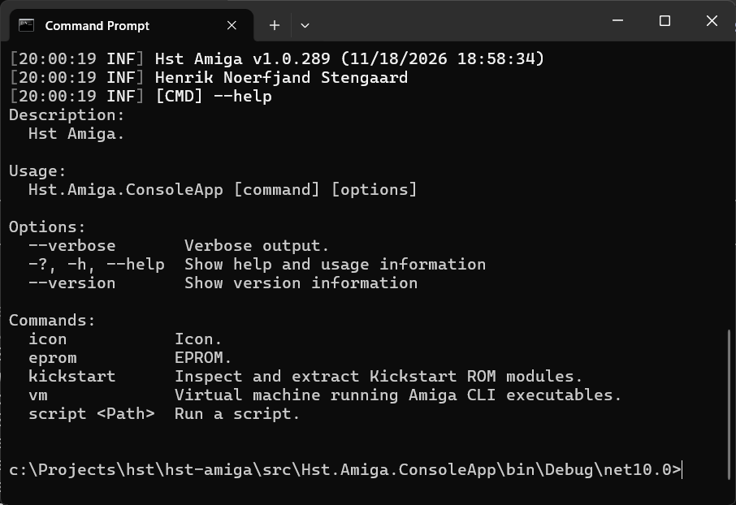

# Hst Amiga console

[](../../assets/hst-amiga-console.png)

Hst Amiga console is an application to create, read and write Amiga related data files. 

## Features

Hst Amiga Console version comes with following features:
- Icons
    - Create and update icons.
    - Import and export icon images, supporting iff, png and bmp image formats.
    - Convert icon images between bit plane, new icon and color icons.

## Supported operating systems

Hst Amiga supports following operating systems:
- Windows
- macOS
- Linux

## Installation

- Download latest Hst Amiga console version from [releases](https://github.com/henrikstengaard/hst-amiga/releases).
- Extract Hst Amiga console zip file.

Hst Amiga is now ready to use.

## Usage

Hst Amiga console application is invoked from the command line using the `hst.amiga` command.

Invoking `hst.amiga` command without any arguments, will display available commands and options.

Example of displaying usage:
```
hst.amiga
```

The command line options for the Hst Amiga console application are listed in the following sections.

## Icon commands

### Display information about icon

Displays information about an icon.

Example of displaying usage for icon info:
```
hst.amiga icon info
```

Example of displaying information about icon info "disk.info":
```
hst.amiga icon info disk.info
```

### Create icon

The create icon command creates a new icon file and optionally import icon images.

Hst Amiga can create following icon types:
- Disk
- Drawer
- Tool
- Project
- Garbage

Hst Amiga can create following icon image types:
- Planar
- NewIcon
- Color icon

Hst Amiga can read icon image from following image formats:
- Png
- Bmp

Example of displaying usage for create icon:
```
hst.amiga icon create 
```

Example of creating a new icon file "disk.info" of icon type "Disk":
```
hst.amiga icon create disk.info disk
```

Example of creating a new icon file "disk.info" of icon type "Disk" and import planar icon image files "image1.png" and "image2.png":
```
hst.amiga icon create disk.info disk --image-type planar --image1-path image1.png --image2-path image2.png
```

### Convert icon images

The convert icon image command converts icon images from one type to another.

Hst Amiga can convert between following icon image types:
- Planar
- New icon
- Color icon

Example of displaying usage for convert icon images:
```
hst.amiga icon image convert
```

Example of converting planar icon images to new icon images for icon file "disk.info":
```
hst.amiga icon image convert disk.info planar newicon
```

Example of converting planar icon images to color icon images for icon file "disk.info":
```
hst.amiga icon image convert disk.info planar coloricon
```

Example of converting auto detected icon images (in order color icon, new icon and planar) to color icon images for icon file "disk.info":
```
hst.amiga icon image convert disk.info auto coloricon
```

### Delete icon images

The delete icon image command deletes icon images from an icon file.

Example of displaying usage for delete icon images:
```
hst.amiga icon image delete
```

Example of deleting all icon images from icon file "disk.info":
```
hst.amiga icon image delete disk.info
```

Example of deleting planar icon images from icon file "disk.info":
```
hst.amiga icon image delete disk.info planar
```

Example of deleting new icon images from icon file "disk.info":
```
hst.amiga icon image delete disk.info newicon
```

### Export icon images

The export icon image command exports icon images from an icon file.

Hst Amiga can export following icon image types:
- Planar
- New icon
- Color icon

Hst Amiga can write icon image in following image formats:
- Png
- Bmp

Example of displaying usage for export icon images:
```
hst.amiga icon image export
```

Example of exporting planar icon images from icon file "disk.info" and save planar icon images as "image1.png" and "image2.png":
```
hst.amiga icon image export disk.info planar --image1-path image1.png --image2-path image2.png
```

Example of exporting planar icon images from icon file "disk.info" using palette file "full-palette.json" and save planar icon images as "image1.png" and "image2.png":
```
hst.amiga icon image export disk.info planar --image1-path image1.png --image2-path image2.png --palette-path "palettes/full-palette.json"
```

Example of exporting new icon images from icon file "disk.info" and save new icon images as "image1.png" and "image2.png":
```
hst.amiga icon image export disk.info newicon --image1-path image1.png --image2-path image2.png
```

Example of exporting color icon images from icon file "disk.info" and save color icon images as "image1.png" and "image2.png":
```
hst.amiga icon image export disk.info coloricon --image1-path image1.png --image2-path image2.png
```

### Import icon images

The import icon image command imports icon images to an icon file.

Hst Amiga can import following icon image types:
- Planar
- New icon
- Color icon

Hst Amiga can read icon image from following image formats:
- Png
- Bmp

Example of displaying usage for import icon images:
```
hst.amiga icon image import
```

Example of importing image files "image1.png" and "image2.png" as planar icon images in icon file "disk.info":
```
hst.amiga icon image import disk.info planar --image1-path image1.png --image2-path image2.png
```

Example of importing image files "image1.png" and "image2.png" as new icon images in icon file "disk.info":
```
hst.amiga icon image import disk.info newicon --image1-path image1.png --image2-path image2.png
```

Example of importing image files "image1.png" and "image2.png" as color icon images in icon file "disk.info":
```
hst.amiga icon image import disk.info coloricon --image1-path image1.png --image2-path image2.png
```

### Import tool types

The import tool types command imports tool types from a file to an icon file. Any existing tool types are replaced with the imported tool types.

Example of displaying usage for import icon images:
```
hst.amiga icon tooltypes import
```

Example of importing tool types from text file "tooltypes.txt" to in icon file "disk.info":
```
hst.amiga icon tooltypes import disk.info tooltypes.txt
```

Example of importing tool types from text file "tooltypes.txt" to in icon file "disk.info" and preserve new icon images in icon file:
```
hst.amiga icon tooltypes import disk.info tooltypes.txt --preserve-newicon
```

### Export tool types

The export tool types command exports tool types from an icon file to a file.

Example of displaying usage for export icon images:
```
hst.amiga icon tooltypes export
```

Example of exporting tool types from icon file "disk.info" to text file "tooltypes.txt":
```
hst.amiga icon tooltypes import disk.info tooltypes.txt
```

Example of exporting tool types from icon file "disk.info" to text file "tooltypes.txt" exclude new icon from tool types:
```
hst.amiga icon tooltypes import disk.info tooltypes.txt --exclude-newicon
```

### Update icon

The update icon command updates properties of an existing icon file:
- Type
- X position
- Y position
- Stack size
- Drawer properties for Disk, Drawer and Garbage icon types that opens a drawer window when double clicked:
  - Drawer X position
  - Drawer Y position
  - Drawer width
  - Drawer height

Example of displaying usage for updating icon:
```
hst.amiga icon update
```

Example of updating x position to 100 and y position to 100 for icon file "disk.info":
```
hst.amiga icon update disk.info -x 100 -y 100
```

Example of updating drawer x position to 100, drawer y position to 100, drawer width to 200 and drawer height to 100 for icon file "disk.info":
```
hst.amiga icon update disk.info --drawer-x 100 --drawer-y 100 --drawer-width 200 --drawer-height 100
```

## EPROM commands

### Build EPROM for A500

The build EPROM command builds EPROM `.bin` files for A500 from a kickstart ROM file.
The kickstart ROM is byte swapped and padded to fit the EPROM size.

Example of displaying usage for build EPROM for A500:
```
hst.amiga eprom build a500
```

Example of building EPROM for A500 from AmigaOS 3.2 kickstart ROM file `kickCDTVa1000a500a2000a600.rom`:
```
hst.amiga eprom build a500 kickCDTVa1000a500a2000a600.rom
```

Example of building EPROM for A500 from AmigaOS 3.2 kickstart ROM file `kickCDTVa1000a500a2000a600.rom` for an AM27C800 EPROM:
```
hst.amiga eprom build a500 kickCDTVa1000a500a2000a600.rom -e am27c800
```

Example of building EPROM for A500 from AmigaOS 3.2 kickstart ROM file `kickCDTVa1000a500a2000a600.rom` for an EPROM of size 1048576 bytes:
```
hst.amiga eprom build a500 kickCDTVa1000a500a2000a600.rom -s 1048576
```

### Build EPROM for A600

The build EPROM command builds EPROM `.bin` files for A600 from a kickstart ROM file.
The kickstart ROM is byte swapped and padded to fit the EPROM size.

Example of displaying usage for build EPROM for A600:
```
hst.amiga eprom build a600
```

Example of building EPROM for A600 from AmigaOS 3.2 kickstart ROM file `kickCDTVa1000a500a2000a600.rom`:
```
hst.amiga eprom build a600 kickCDTVa1000a500a2000a600.rom
```

Example of building EPROM for A600 from AmigaOS 3.2 kickstart ROM file `kickCDTVa1000a500a2000a600.rom` for an AM27C800 EPROM:
```
hst.amiga eprom build a600 kickCDTVa1000a500a2000a600.rom -e am27c800
```

Example of building EPROM for A600 from AmigaOS 3.2 kickstart ROM file `kickCDTVa1000a500a2000a600.rom` for an EPROM of size 1048576 bytes:
```
hst.amiga eprom build a600 kickCDTVa1000a500a2000a600.rom -s 1048576
```

### Build EPROM for A2000

The build EPROM command builds EPROM `.bin` files for A2000 from a kickstart ROM file.
The kickstart ROM is byte swapped and padded to fit the EPROM size.

Example of displaying usage for build EPROM for A2000:
```
hst.amiga eprom build a2000
```

Example of building EPROM for A2000 from AmigaOS 3.2 kickstart ROM file `kickCDTVa1000a500a2000a600.rom`:
```
hst.amiga eprom build a2000 kickCDTVa1000a500a2000a600.rom
```

Example of building EPROM for A2000 from AmigaOS 3.2 kickstart ROM file `kickCDTVa1000a500a2000a600.rom` for an AM27C800 EPROM:
```
hst.amiga eprom build a2000 kickCDTVa1000a500a2000a600.rom -e am27c800
```

Example of building EPROM for A2000 from AmigaOS 3.2 kickstart ROM file `kickCDTVa1000a500a2000a600.rom` for an EPROM of size 1048576 bytes:
```
hst.amiga eprom build a2000 kickCDTVa1000a500a2000a600.rom -s 1048576
```

### Build EPROM for A1200

The build EPROM command builds EPROM `.bin` files for A1200 from a kickstart ROM file.
The kickstart ROM is split into hi and lo EPROMs by word size, byte swapped and padded to fit the EPROM size.

Example of displaying usage for build EPROM for A1200:
```
hst.amiga eprom build a1200
```

Example of building EPROM for A1200 from AmigaOS 3.2 kickstart ROM file `kicka1200.rom`:
```
hst.amiga eprom build a1200 kicka1200.rom
```

Example of building EPROM for A1200 from AmigaOS 3.2 kickstart ROM file `kicka1200.rom` for an AM27C800 EPROM:
```
hst.amiga eprom build a1200 kicka1200.rom -e am27c800
```

Example of building EPROM for A1200 from AmigaOS 3.2 kickstart ROM file `kicka1200.rom` for an EPROM of size 1048576 bytes:
```
hst.amiga eprom build a1200 kicka1200.rom -s 1048576
```

### Build EPROM for A3000

The build EPROM command builds EPROM `.bin` files for A3000 from a kickstart ROM file.
The kickstart ROM is split into hi and lo EPROMs by word size, byte swapped and padded to fit the EPROM size.

Example of displaying usage for build EPROM for A3000:
```
hst.amiga eprom build a3000
```

Example of building EPROM for A3000 from kickstart ROM file `kicka3000.rom`:
```
hst.amiga eprom build a3000 kicka3000.rom
```

Example of building EPROM for A3000 from AmigaOS 3.2 kickstart ROM file `kicka3000.rom` for an AM27C800 EPROM:
```
hst.amiga eprom build a3000 kicka3000.rom -e am27c800
```

Example of building EPROM for A3000 from AmigaOS 3.2 kickstart ROM file `kicka3000.rom` for an EPROM of size 1048576 bytes:
```
hst.amiga eprom build a3000 kicka3000.rom -s 1048576
```

### Build EPROM for A4000

The build EPROM command builds EPROM `.bin` files for A4000 from a kickstart ROM file.
The kickstart ROM is split into hi and lo EPROMs by word size, byte swapped and padded to fit the EPROM size.

Example of displaying usage for build EPROM for A4000:
```
hst.amiga eprom build a4000
```

Example of building EPROM for A4000 from kickstart ROM file `kicka4000.rom`:
```
hst.amiga eprom build a4000 kicka4000.rom
```

Example of building EPROM for A4000 from AmigaOS 3.2 kickstart ROM file `kicka4000.rom` for an AM27C800 EPROM:
```
hst.amiga eprom build a4000 kicka4000.rom -e am27c800
```

Example of building EPROM for A4000 from AmigaOS 3.2 kickstart ROM file `kicka4000.rom` for an EPROM of size 1048576 bytes:
```
hst.amiga eprom build a4000 kicka4000.rom -s 1048576
```

### Fill EPROM

The fill EPROM command fills an EPROM file from kickstart rom by concatenating it until the EPROM size is reached.

The zero fill option fills the EPROM with zeroes until the EPROM size is reached instead of concatenating the kickstart ROM multiple times.

Example of displaying usage for fill EPROM:
```
hst.amiga eprom fill
```

Example of filling EPROM for A500 from AmigaOS 3.2 kickstart ROM file `kickCDTVa1000a500a2000a600.rom` for an AM27C800 EPROM:
```
hst.amiga eprom fill kickCDTVa1000a500a2000a600.rom -e am27c800
```

Example of filling EPROM for A500 from AmigaOS 3.2 kickstart ROM file `kickCDTVa1000a500a2000a600.rom` for an EPROM of size 1048576 bytes:
```
hst.amiga eprom fill kickCDTVa1000a500a2000a600.rom -s 1048576
```

### Byte swap EPROM

The byte swap EPROM command byte swaps an EPROM file by byte swapping 16-bit words from a kickstart ROM file.
As an example bytes 0x00, 0x01, 0x02, 0x03 are byte swapped to 0x01, 0x00, 0x03, 0x02.

Example of displaying usage for byte swap EPROM:
```
hst.amiga eprom byteswap
```

Example of byte swapping EPROM for A500 from kickstart ROM file `kickCDTVa1000a500a2000a600.rom`:
```
hst.amiga eprom byteswap kickCDTVa1000a500a2000a600.rom
```

### Script

Run multiple commands using a script file.
It takes a small overhead of time for the operating system to execute Hst Amiga and by supporting multiple commands can be run, it's faster than running Hst Amiga multiple times.


Example of displaying usage for script:
```
hst.amiga script
```

Example of a script file:
```
icon create drawer.info drawer
icon update drawer.info -x 100 -y 100
```

Example of running a script file `example.txt`:
```
hst.amiga script example.txt
```

## Vm commands

### Run Amiga executable

Runs an Amiga CLI executable in a virtual machine, similar to vamos from amitools.
The executable runs on an emulated 68000 or 68020 cpu with exec.library, dos.library, utility.library, version.library and math libraries emulated, mapping Amiga volumes to host directories and the Amiga console to standard input and output.
Libraries other than these aren't available, except intuition.library and graphics.library stubs, which can be opened, but stop the program if any function is called.

The return code of the Amiga executable is returned as exit code. Pressing ctrl-c sends a break signal to the program and pressing ctrl-c again stops the program.

Arguments after the executable are passed to the program. Use `--` before arguments starting with `-`, so they are not parsed as options.

Amiga names, protection bits and comments are read from UAE metadata, UAEFSDB `_UAEFSDB.___` files used by WinUAE and UAE metafiles `.uaem` used by FS-UAE, detected per directory. Use `--uae-metadata` to select `uaefsdb`, `uaemetafile` or `none` instead of `auto`. Metadata files are not changed by default and changes to protection bits and comments are kept in memory while the program runs. Use `--write-uae-metadata` to write changes to metadata files.

Example of displaying usage for run Amiga executable:
```
hst.amiga vm run
```

Example of running Amiga executable `hello` with SYS: mapped to current directory:
```
hst.amiga vm run hello
```

Example of running Amiga executable `list` with SYS: mapped to directory `c:\amiga\sys` and current directory SYS:Work:
```
hst.amiga vm run c:\amiga\sys\c\list -V SYS=c:\amiga\sys --cwd SYS:Work -- #?.txt
```

Example of running Amiga executable `copy` with volume WORK: mapped to directory `d:\work` and an assign DATA: to `WORK:data`:
```
hst.amiga vm run copy -V SYS=c:\amiga\sys -V WORK=d:\work -a DATA=WORK:data -- DATA:file.txt TO RAM:
```

Example of running Amiga executable `protect` adding script protection bit to file `test` written to UAE metadata:
```
hst.amiga vm run c:\amiga\sys\c\protect -V SYS=c:\amiga\sys --write-uae-metadata -- SYS:test s add
```

Example of running Amiga executable `test` emulating a 68000 cpu with 2 MB memory and tracing library calls:
```
hst.amiga vm run test -c 68000 -m 2 --trace-libs
```

#### Adf and disk images

The executable can be a path to a file in an adf or disk image file, e.g. `workbench.adf\c\list`. Paths in disk images with a rigid disk block start with `rdb`, the partition number starting from 1 or the device name of the partition, e.g. `disk.vhd\rdb\1\c\list` or `disk.vhd\rdb\dh0\c\list`. Virtual hard disk files `.vhd` and raw images like `.hdf` and `.img` are supported. The executable is read from the image and runs with host directories mapped as volumes.

Use `--image-context` to run the executable in the context of the image instead. The image is mounted, so file access is in the Amiga file systems of the image, using FFS, PFS3 and SFS file system support of Hst Amiga:
- Adf is mounted as DF0: and SYS: is assigned to DF0:.
- Partitions in a disk image are mounted with their device names, e.g. DH0: and DH1:, and SYS: is assigned to the bootable partition with highest boot priority.
- Volumes are added with their volume names, e.g. Workbench:, and device names are assigns to volumes. C:, S:, L:, LIBS: etc. are assigned to directories in SYS:.
- RAM:, T: and ENV: are mapped to a temporary host directory and host directories can still be mapped as volumes with `-V`.

Use `--image` to mount adf and disk images with `run`, `execute` and `shell` commands. Adf images are mounted as DF0:, DF1: etc. in order and SYS: is assigned to the first image. With `run` the executable can then be an Amiga path, e.g. `C:List`.

Images are opened read only by default and volumes are write protected, so writing fails with `disk is write-protected`. Use `--write-image` to open images for writing.

Example of running Amiga executable `list` from adf listing current directory with SYS: mapped to current directory:
```
hst.amiga vm run workbench.adf\c\list
```

Example of running Amiga executable `list` from adf in the context of the adf listing SYS:, which is the root of the adf:
```
hst.amiga vm run --image-context workbench.adf\c\list -- SYS:
```

Example of running Amiga executable `list` from first partition in disk image in the context of the disk image listing DH0:
```
hst.amiga vm run --image-context disk.vhd\rdb\1\c\list -- DH0:
```

Example of running Amiga executable `version` from SYS: of disk image:
```
hst.amiga vm run --image disk.vhd C:Version
```

Example of running an interactive shell with adf mounted for writing:
```
hst.amiga vm shell --image workbench.adf --write-image
```

### Execute AmigaDOS script

Executes an AmigaDOS script in the virtual machine with the Execute command from C:, e.g. from an AmigaOS 3.1 Workbench installation mapped to SYS:. Execute handles `.KEY` arguments and the virtual machine shell runs the script lines with the AmigaOS 3.1 shell internal commands like `If`, `Skip`, `Echo` and `Set`. Commands run synchronously, as there is no multitasking. The script is a host path or an Amiga path and the options are the same as for running an Amiga executable.

Running the Execute command with `vm run` runs the script too.

Example of executing script `SPat` from Workbench running `list` for each file matching pattern `sys:c/a#?`:
```
hst.amiga vm execute SYS:S/SPat -V SYS=c:\amiga\sys -- list sys:c/a#?
```

Example of executing script `build.script` in host directory `d:\work` with an argument:
```
hst.amiga vm execute d:\work\build.script -V SYS=c:\amiga\sys -- release
```

### Run interactive AmigaDOS shell

Runs an interactive AmigaDOS shell in the virtual machine, reading command lines from console input until `EndShell` or end of input. The options are the same as for running an Amiga executable.

Example of running an interactive shell with SYS: mapped to directory `c:\amiga\sys`:
```
hst.amiga vm shell -V SYS=c:\amiga\sys
```
